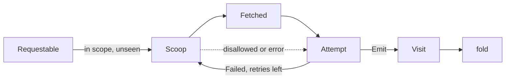
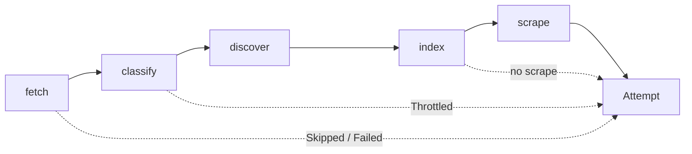
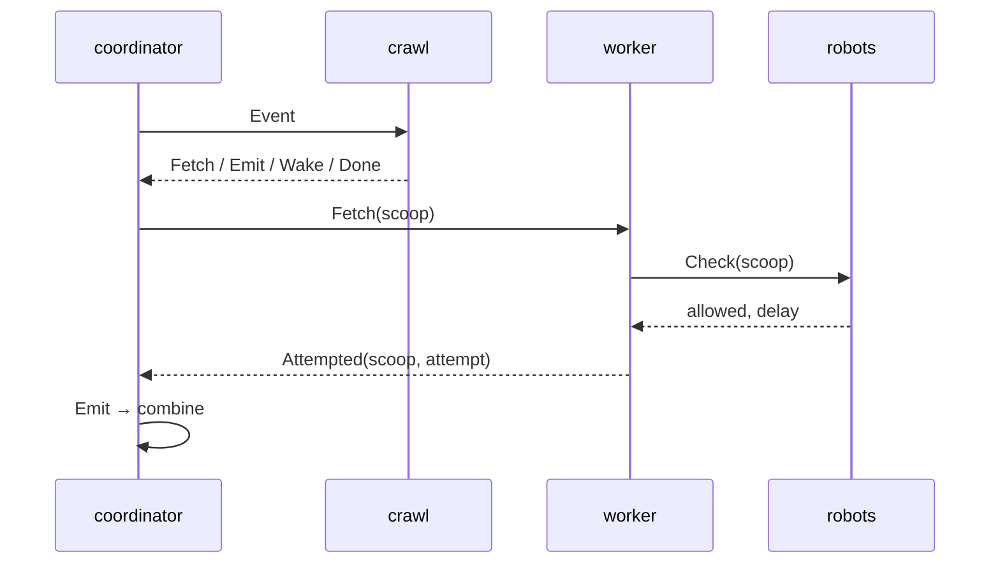

# TODO

I know this is LLM generated but this is my way of brainstorming and keeping track of tasks. The code will still be hand written, because that's the fun part and why i'm doing it.

## Architecture

Pure modules decide, processes only wire. Modules follow the domain, few and large.
`Requestable → Scoop → Fetched → Attempt → Visit`

Modules: public `spoon`, `spoon/page`, `spoon/visit`; internal `requestable`, `frontier`, `crawl` (with `Attempt` and scope), `fetcher` (stages and link discovery), `robots`, `coordinator`, `worker`.

| Word | Means | Module |
|---|---|---|
| `Requestable` | a checked address | `requestable` |
| `Scoop` | a URL waiting in or taken from the frontier | `frontier` |
| `Fetched` | a scoop with its response, inside the worker | `fetcher` |
| `Attempt` | result of one try; may be retried | `crawl` |
| `Visit` | final result for one URL; what `fold` gets | `visit` |
| `Responded` / `Skipped` / `Failed` | the three outcomes, same in `Attempt` and `Visit` | |
| `Skip` | why it wasn't fetched | `visit` |
| `Failure` | why a try failed | `visit` |
| `Attempted` | message: one try for this scoop is over | coordinator, crawl |
| `Emit` | effect: hand this `Visit` to `fold` | crawl |

## Decisions

- No `follow` hook; rules for every URL are scope, per-page link choices are `scrape`
- No `fold_until`; early stop is knobs, `page.set_links(page, [])` or `spoon.stop`
- `max_pages` counts responses, not skips

## Done

- [x] Plain record `spoon/visit.Visit(item)`: `url`, `depth`, `outcome`
- [x] `Outcome(item) = Responded(status, links: List(Uri), item: Option(item)) | Skipped | Failed`
- [x] `scrape(fn(Page(item), Response(String)) -> Page(item))` is the only hook; default returns the page unchanged, so `item: None`
- [x] Opaque `spoon/page.Page(item)` with `url`, `links`, `set_item`
- [x] Prefill: anchors minus `rel=nofollow`, `Location` on redirects; resolved against the page, non-requestable dropped
- [x] Worker code moved from `coordinator` into `fetcher`

## Phase 0: commit

- [ ] Commit the current green state

## Phase 1: types

- [ ] `visit.Skip = Disallowed | RobotsUnavailable`, renamed from `SkipReason`
- [ ] `visit.Failure = Network | Timeout | Throttled(retry_after_ms) | BadResponse | Crashed`
- [ ] Delete `HttpError`; transports return `visit.Failure`; `default_fetch` maps `ResponseTimeout` to `Timeout`
- [ ] `crawl.Attempt(item) = Responded | Skipped(Skip) | Failed(Failure)`; `Responded` carries `Requestable` links and `crawl_delay_ms`; one message `Attempted(scoop, attempt)`, a worker crash sends `Failed(Crashed)`

## Phase 2: core

- [ ] `crawl.update(Event(item)) -> List(Effect(item))`; `Event = Attempted | Woke`, `Effect = Fetch | Emit(Visit) | Wake | Done`
- [ ] Scope, visit building and giving up move into `crawl`; coordinator only translates messages and runs effects
- [ ] `crawl` emits `Emit(Visit(Failed))` when retries run out, so `fold` sees each `Failed` once
- [ ] `Scoop.parent` and `Visit.parent: Option(Uri)`: first page the URL was found on, `None` for seeds; all referrers come from inverting `links`
- [ ] `fold` gets a `Visit`; integration test asserts on visits, `/forbidden` and `/noindex` included
- [ ] Fill `site_audit_builds_graph_with_redirect_edges_test`

## Phase 3: fetcher stages

- [ ] `fetch → classify → discover → index → scrape` over `Fetched(scoop, crawl_delay_ms, response, page)`; early exit as `Result(Fetched, Attempt)`
- [ ] `scrape` only on 2xx without noindex
- [ ] No links on meta nofollow
- [ ] Tests for `requestable.resolve` and link discovery
- [ ] Fill `scraper_collects_many_items_per_page_test` and `indexer_writes_each_page_to_a_store_test`

## Phase 4: settings

- [ ] Builder holds `crawl.Settings` (with scope) and `fetcher.Settings(item)`; delete `config`; `robots.Settings` built at start from the fetcher settings

## Phase 5: API leftovers

- [ ] `page.depth`, `page.filter_links`
- [ ] `page.resolve(page, Uri) -> Result(Requestable, Nil)`; `add_link`/`set_links` take `Requestable`
- [ ] Delete `middleware` and `page.Link`; docs still mention `on_page` and middleware
- [ ] `start` with `await`/`stop`/`stats`; `fold` = start + await, `run` = fold over Nil
- [ ] `spoon.supervised` child spec for an app's own supervision tree
- [ ] `spoon.Error` instead of `actor.StartError`
- [ ] Fill `embedded_crawl_starts_stops_and_reports_progress_test`

## Phase 6: features

### Scope and bounds

- [ ] Redirect hop limit; redirects don't increment depth
- [ ] Per-origin queued cap, global `max_frontier` (drop and count, never block)
- [ ] Maximum URL length
- [ ] Path include/exclude as a scope knob; also covers links `scrape` never sees (redirects, noindex pages)
- [ ] Subdomain matching as an explicit option
- [ ] Sitemap ingestion via `extract.sitemap_locs`; needs `grip.sitemaps`
- [ ] `spoon.check_external`: out-of-scope links become leaves (fetched for status, never expanded) instead of dropped; scope as `Crawl | Check | Drop` later, with path include/exclude
- [ ] Leaf: robots and per-origin delay apply, no `scrape`, no anchors; `Visit` is `Responded(status, [], None)`, `Skipped` or `Failed`
- [ ] Leaf follows `Location` as a leaf, bounded by the hop limit, so a 301 doesn't hide a dead link
- [ ] Leaves count toward `max_pages`
- [ ] Internal: `Scoop.leaf`, inherited by a leaf's `Location` target; `crawl` splits by scope; `fetcher` skips `scrape` and anchors
- [ ] Leaves send HEAD via `request.set_method` after `to_request`
- [ ] Fill `link_checker_reports_dead_links_with_referrers_test`

### Fetch rework (breaking, decide before 1.0)

- [ ] `options: fetch.Options(timeout_ms, max_body_size)` + `make_fetch: fn(Options) -> Fetch`
- [ ] Resolved once at start, so setters and a swapped transport compose in any pipe order
- [ ] Flat setters `spoon.fetch_timeout`, `spoon.max_body_size`
- [ ] `user_agent` and `spoon.headers` go on the `Request`; `Options` stays transport-advisory
- [ ] `Fetch` returns `Response(BitArray)`; charset decode worker-side
- [ ] Contract: never follow redirects, don't strip spoon's headers
- [ ] Skip bodies by `Content-Type`/`Content-Length` where the transport can

## Housekeeping

- [ ] Rename `policy_cache` to `robots`; name the domain, not the implementation
- [ ] Remove the demo

## Later / maybe

- [ ] Resumable crawls: swappable visited-set store, ETags, wall time only there
- [ ] Frontier `Slot` lifecycle as an explicit union with `update`
- [ ] JS target; only the OTP shell needs a counterpart
- [ ] Links past `max_depth` as leaves; crawl marks seen before the depth guard, so a URL first found there never expands
- [ ] Per-job deadline in the worker manager: `send_after` + kill → `Failed(TooSlow)`, not retried; a hung `scrape` currently blocks `Done` forever
